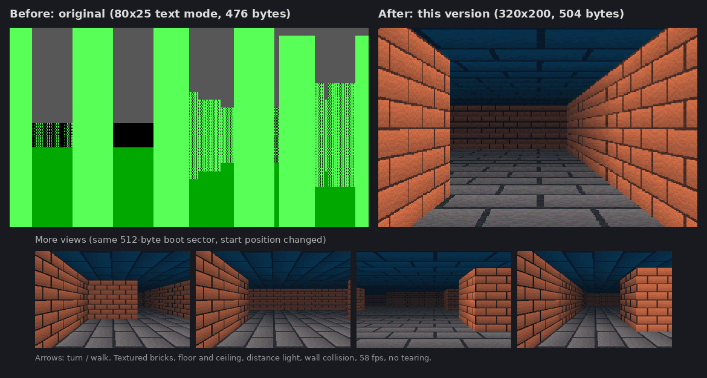

# Boot Sector Raycasting

A 3D raycasting engine that fits entirely inside a 512-byte floppy boot sector (`504 / 510` bytes used before the `0x55 0xAA` boot signature), running in **VGA mode `13h` (320×200, 256 colours)** with no operating system and no floating-point instructions.



## What's New in This Fork ([`raycaster.asm`](raycaster.asm))

This fork rewrites the original 80×25 text-mode raycaster into a full 320×200 256-colour textured maze while keeping the original 16×16 bit-packed map and 512-byte boot sector constraint:

- **Full Movement & Collision**: Turn with `Left` / `Right` arrow keys and walk forward/backward with `Up` / `Down` arrow keys (with wall collision checks).
- **Procedural Textures & Lighting**: Generates a 256×256 staggered brick & mortar texture with PRNG noise at boot (with a darker variant for Y-facing walls) and programs 4×64-shade VGA palette ramps (stone floor, upper/lower brick walls, dark-blue ceiling) with distance shading and fog.
- **Perspective-Correct Walls, Floor & Ceiling**: Draws each screen column in symmetric top/bottom row pairs (`99 - j` and `100 + j`), switching from perspective-divided (`65536 / h`) textured floor & ceiling slabs to textured brick walls when `h * distance < 32768`.
- **Trigonometry-Free Camera & Two-Step Ray Marching**:
  - Rotates the 16.16 fixed-point view vector in place using **Minsky's circle rotation** (`a -= b/32`, `b += a/32`)—no sine lookup table needed.
  - Casts rays along `dir + perp(dir) * (col - 160) / 256` (~64° FOV), measuring perpendicular distance directly to avoid fish-eye distortion.
  - Marches in coarse steps (`1/20` cell) until hitting a wall bit (`bt` on the 16×16 map), then backs up one step and refines in `1/8` sub-steps (`~1/164` cell).
- **Smooth 58 FPS Double Buffering**: Reprograms PIT channel 0 to ~58 ticks/sec, renders into an off-screen segment (`0x2000`), and copies the finished frame to VGA memory (`0xA000`) with a single `fs rep movsw`.

## Quick Start

Requires `nasm`, `qemu-system-i386`, and `python3` (for the byte-usage report).

| Action | Command |
| :--- | :--- |
| Assemble `raycaster.asm`, build `floppy.img`, and show byte usage | `make` |
| Play the 320×200 textured version in QEMU | `make run-qemu` |
| Run the original 80×25 green text-mode version for comparison | `make run-original` |
| Disassemble `raycaster.bin` (16-bit @ `0x7C00`) | `make disasm` |
| Remove generated build files | `make clean` |

Or boot the pre-built 512-byte binary directly:

```bash
qemu-system-i386 -drive format=raw,file=raycaster.bin
```

---

## Original Version ([`Boot-Sector-Raycasting.asm`](Boot-Sector-Raycasting.asm))

This is a 3D raycasting engine that can fit entirely inside the boot sector of a floppy disk. As a result, the program is exactly 512 bytes large, uses no floating point arthmetic, and, in a strange sort of way, is its own tiny operating system (technically it takes the place of a boot loader, but this sounds cooler). It makes use of the same technique emplyed by the first Wolfenstein 3D game, but has half a kilobyte to work with for all machine code and data memory.

Here's a look at the machine code that makes it tick. This contains the map data, a sin function approximation, all of the redering logic, and input handling:


And here's the program running on an Intel 386 VM. It doesn't look great, but I can assure you even this took many hours to accomplish. 3D without floating point is hard, even more so with only 512 bytes for everything! Of course it doesn't help that I'm not particularly good at x86.


### How the Original Works
I won't go into raycasting here, since that's explained all over the place (e.g. https://en.wikipedia.org/wiki/Wolfenstein_3D#Development). Instead, I'll go over some of the techniques that were used to force this thing to work against its will (this is an angry piece of software). First, the elephant in the room: how to do something like this without floating point, especially considering that trignometry is pretty much non-negotiable for this method. In a nutshell, any time fractional values were needed, I just stored the value times 128. This allowed for seven binary decimal places! Using a factor of 128 is especially convenient since we can divide this factor away and round down using bitwise right shifting instead of the div instruction, which saves a LOT of instruction memory (div instructions require a lot of mov instructions to set up and extract the result, whereas shl is only 2 bytes). 

As for how sin is calculated, the obvious choice (without using floating point) is to use a lookup table of sin values times 128. Unfortunately, this also uses a tremendous about of memory, so I had to eliminate it as an option pretty quickly. The comprimise was to use 6 different linear approximations for sin(x) times 128 that work well in different intervals of x, and then create a lookup table of these approximations. This is usually sufficient to get within 1-2% of the actual value of 128sin(x), which was good enough to make the sloppy looking image you see above! Is it jank? 100%. But does it work well enough for this silly exercise? I'm gonna go ahead and possibly yes! 

The last thing I'll mention is how the map is encoded. To save space it's a 16x16 cell map stored as 16 16-bit integers, with bit i of number j in the array representing the
wall status of map cell (i, j) (i.e. a wall is present at (i, j) iff the corresponding bit location is a 1).

### Running the Original Program
You can assemble the program youself using flat assembler (http://flatassembler.net/), or just use `make run-original` / the `Boot-Sector-Raycasting.bin` binary provided in the repo! I'd recommend running it using the qemu (https://www.qemu.org/) i386 emulator, but given that this is tecnically a boot loader, you can 100% put this into the boot sector of a USB, floppy disk, or hard drive and boot to it! Oh, and you can use the left and right arrow keys to looks around!

